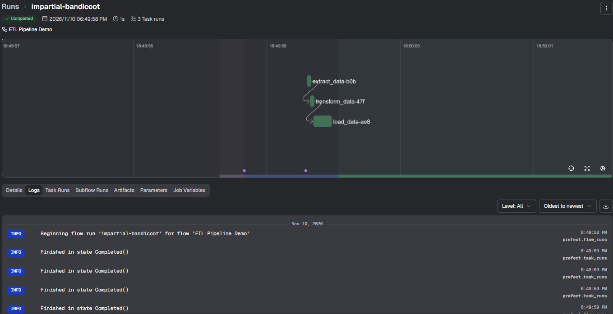
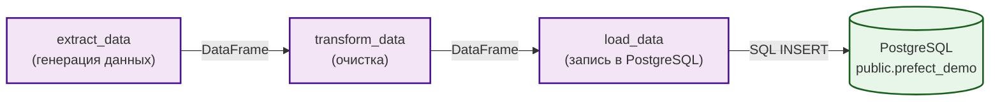

# 🚀 Prefect Orchestration Demo

Pet-проект: оркестрация ETL-пайплайна с использованием **Prefect**. Демонстрирует Python-нативный подход (декораторы `@flow` и `@task`), динамическое выполнение и визуализацию в Prefect UI.

## 📸 Скриншот

**Граф выполнения Flow (Extract → Transform → Load):**



## 🎯 Зачем это

Prefect — это современный оркестратор, который, в отличие от Airflow, позволяет писать обычные функции Python и оборачивать их в декораторы `@flow` и `@task`. Это делает код более читаемым и гибким. В этом проекте показано, как построить простой ETL-пайплайн (извлечение → очистка → загрузка в PostgreSQL) и визуализировать его в Prefect UI.

## 🏗 Архитектура



## 📂 Структура

```
prefect-orchestration-demo/
├── flows/
│   └── etl_pipeline.py    # ETL-пайплайн на Prefect
├── assets/
│   └── prefect_flow.png   # Скриншот графа
├── README.md
└── requirements.txt
```

## 🚀 Запуск

1. Установи зависимости:
```bash
pip install -r requirements.txt
```

2. Запусти Prefect server (в отдельном окне):
```bash
prefect server start
```

3. Установи переменную окружения (в Windows):
```cmd
set PREFECT_API_URL=http://127.0.0.1:4200/api
```

4. Запусти flow (из корня проекта):
```bash
python flows/etl_pipeline.py
```

5. Открой Prefect UI: `http://localhost:4200`.

## 📊 Результаты

- **Flow успешно выполнен** (2 запуска, все задачи Completed).
- **Данные загружены** в таблицу `public.prefect_demo` (174 строки за два запуска).
- **Граф задач** визуализирован в Prefect UI.

## 🔗 Связанные проекты

- [`airflow-e2e-api-pipeline`](https://github.com/nconichtchenko-arch/airflow-e2e-api-pipeline) — пример на Airflow.
- [`dagster-orchestration-demo`](https://github.com/nconichtchenko-arch/dagster-orchestration-demo) — пример на Dagster.

## 📫 Контакты

- **GitHub:** [github.com/nconichtchenko-arch](https://github.com/nconichtchenko-arch)
- **Email:** pavloni@mail.ru
- **Формат работы:** удалённо
